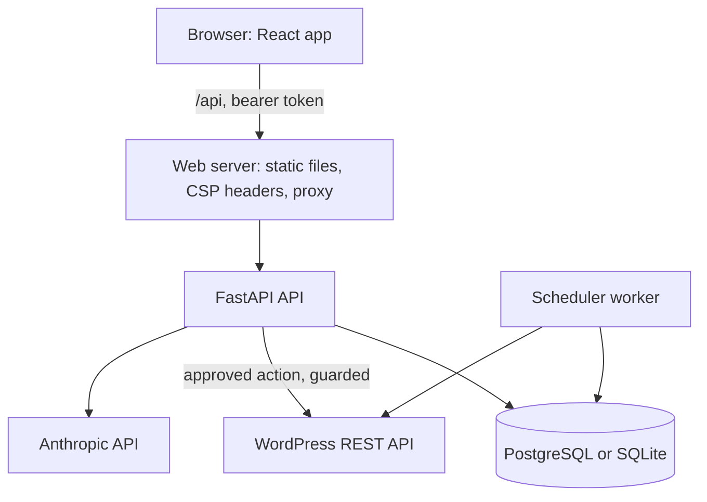
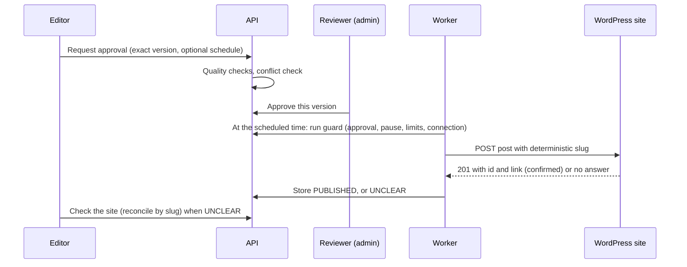
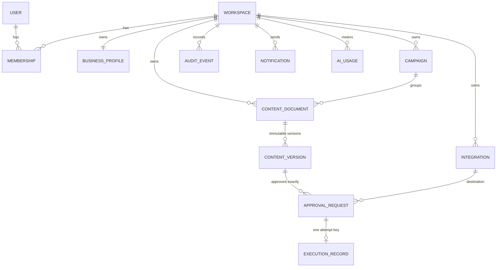

# Architecture
## System

The API and the worker are separate processes sharing one database and one secret key. The worker writes a heartbeat; the dashboard says the agent is "Running" only while that heartbeat is fresh.

## Publishing, step by step

## Database relationships

`WORKER_HEARTBEAT` and `LOGIN_ATTEMPT` are standalone tables. Added in v7: `THEME_SETTINGS` (workspace or global scope, owner-controlled colours, default mode, whether people may choose their own), `AI_PROVIDER_CONFIGS` (one per workspace) and `AI_PROVIDER_HEALTH` (last real test per provider); `MEMBERSHIPS` gained `suspended` and `theme_mode`, `WORKSPACES` gained `admin_revoked`, `AI_USAGE` gained `provider`.

## Key decisions
- Anthropic is the AI provider; the adapter is isolated in `services/llm.py` so another provider can be added.
- A database-backed scheduler is used instead of Redis and Celery. It is restart-safe and enough for this size. Move to a queue when load demands it.
- Idempotency: one `execution_records` row per approval (unique key) plus a deterministic post slug for reconciliation.
- Secrets: WordPress passwords are encrypted with a key derived from `APP_SECRET_KEY`. Rotating the key requires reconnecting accounts.

## AI provider layer (v7)
`services/providers.py` holds one thin adapter per provider (list models, complete). `services/llm.py` asks the workspace's saved selection (`ai_config.resolve_cfg`) or falls back to the server environment. Fallback to a second provider happens only when the Owner turned it on; the result then says so (`fallback_used`, `primary_error`) and both attempts are counted in usage.
