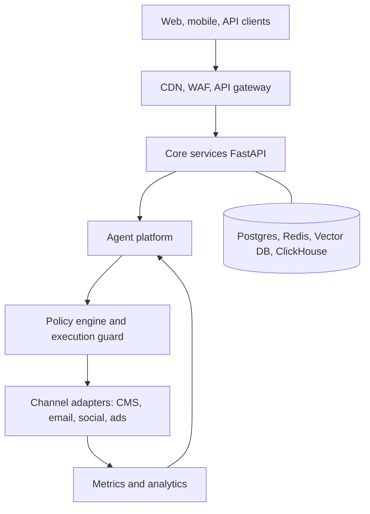
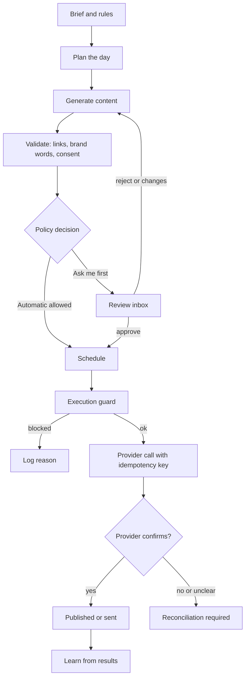
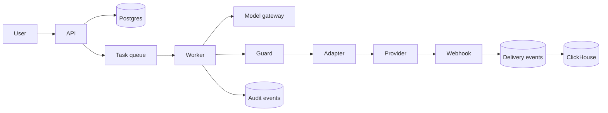
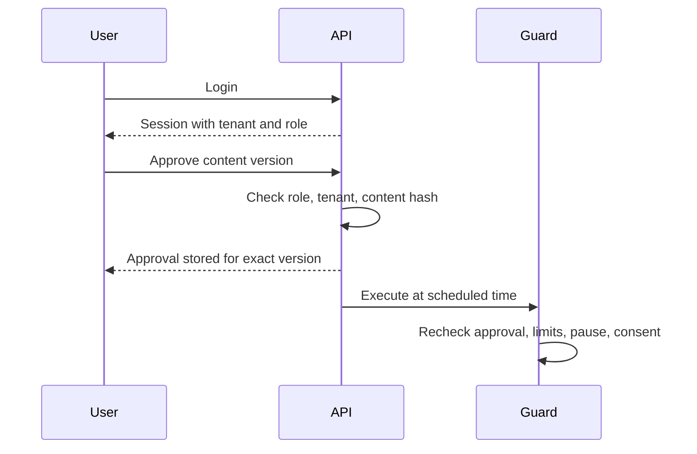
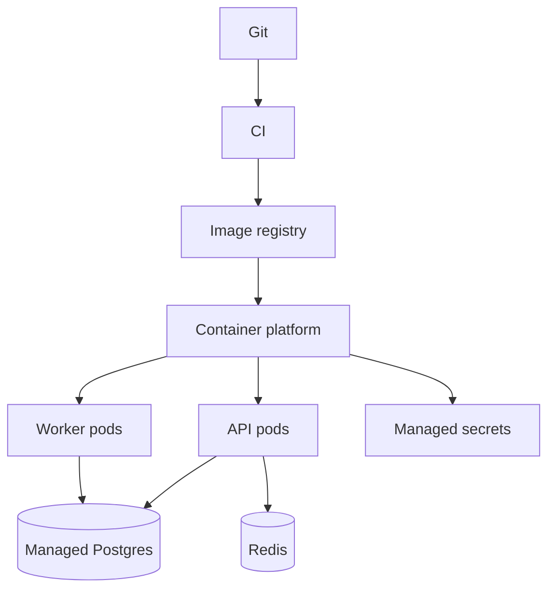
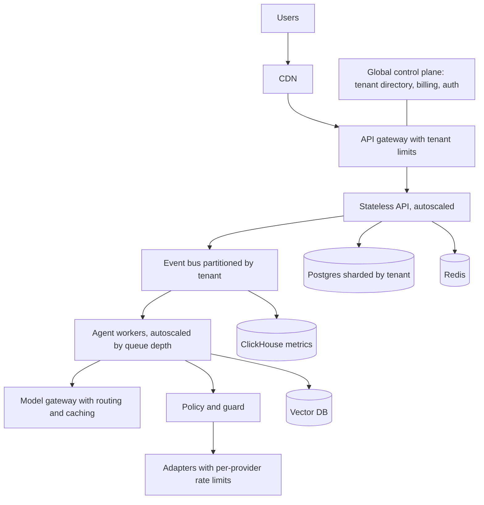

# Architecture
These are designs. Capacity numbers are targets until load tests prove them.

## 1. System

## 2. Agent execution flow

## 3. Data flow

## 4. Authentication and approval

## 5. Deployment

## 6. Scale design for 10 million registered users (target, untested)
Assumptions to validate: 1 percent daily active (100,000 users), about 20 agent actions per tenant per day, peaks at 5 times average.

Needed before claiming capacity: load tests, shard rebalancing test, provider rate-limit test, cost model.
